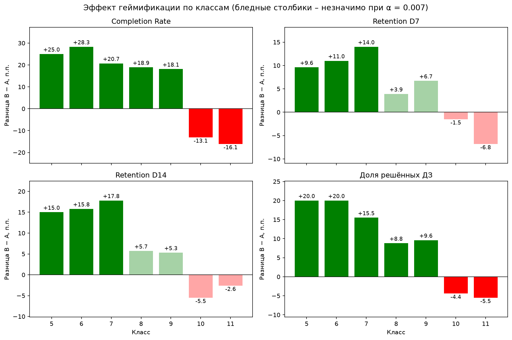

# gamification-ab A/B-тест геймификации на образовательной платформе

Анализ A/B-теста системы достижений за регулярное решение задач на EdTech-платформе для школьников 5–11 классов.

## Задача

Продуктовая команда предположила, что геймификация личного кабинета повысит **Completion Rate** и **Retention** (7-й и 14-й день). Нужно проверить корректность эксперимента, оценить эффект и дать рекомендацию: раскатить фичу, доработать или отказаться.

## Главный результат

В целом геймификация значимо улучшает все метрики (p < 0.001):

| Метрика | Контроль (A) | Тест (B) | Разница |
|---|---|---|---|
| Completion Rate | 72.1% | 83.7% | **+11.7 п.п.** |
| Retention D7 | 72.7% | 78.0% | **+5.3 п.п.** |
| Retention D14 | 28.8% | 36.2% | **+7.4 п.п.** |
| Доля решённых ДЗ | 34.6% | 43.8% | **+9.2 п.п.** |

Но эффект **зависит от класса**: в 5–9 классах Completion Rate растёт на 18–28 п.п., а в 10–11 классах **падает** на 13–16 п.п.



## Рекомендация

**Раскатить геймификацию на 5–9 классы. Для 10–11 классов – не раскатывать и отправить механику на доработку.**

## Что сделано

1. **Подготовка данных:** удалены дубликаты событий, 8 пользователей в обеих группах, 12 ботов
2. **Sanity check:** проверка пересечения групп, SRM, баланса групп по классам
3. **Метрики на уровне пользователя:** Completion Rate, Retention D7/D14, доля решённых ДЗ
4. **EDA:** конверсионная воронка, распределения метрик
5. **Статистика:** z-тест для пропорций, t-тест Уэлча, Манн – Уитни, доверительные интервалы, MDE, bootstrap, поправка Бонферрони
6. **Проверка устойчивости:** вывод не зависит от порога определения Completion Rate
7. **Сегментация по классам:** выявлен неоднородный эффект

## Структура проекта

```
gamification-ab/
├── data/raw/                      # исходные данные
├── notebooks/
│   └── ab_test_analysis.ipynb     # основной анализ
├── figures/                       # графики
├── presentation/                  # презентация для бизнеса
├── requirements.txt
└── README.md
```

## Как запустить

Python 3.12+

```bash
git clone https://github.com/aleksandr-klushin/gamification-ab.git
cd gamification-ab
python3 -m venv venv
source venv/bin/activate        # Windows: venv\Scripts\activate
pip install -r requirements.txt
jupyter notebook notebooks/ab_test_analysis.ipynb
```


## Стек

Python, pandas, NumPy, SciPy, statsmodels, matplotlib